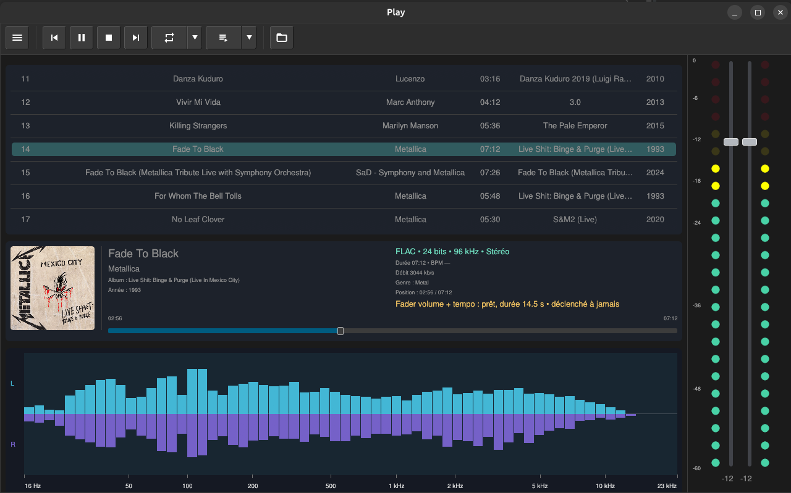

# Play

Play est le playground multiplateforme issu des idées et des applications de
`Exec_modernise` V1. Le projet vise Linux, Windows et macOS avec un modèle
partagé en Rust et une interface native de bureau portée directement par
`egui`.

Le workspace est organisé en applications (`apps/`) et bibliothèques
partagées (`crates/`). L'interface desktop assemble ces bibliothèques sans
faire entrer `egui`, `winit` ou les API audio système dans les contrats
portables.



## État actuel

Le binaire `play` ouvre une fenêtre native `winit` rendue par `egui-wgpu`. La
session démarre avec une liste de pistes vide et propose :

- une barre d'outils compacte inspirée de TacticalGlobe, avec ses boutons
  38×38 et ses textures normale/enfoncée dans `assets/texture/` ;
- les commandes menu, précédent, lecture/pause, arrêt, suivant, répétition,
  enchaînement et chargement de fichiers ;
- le choix entre les modes `Player`, `RoomAnalyzer`, `LiveTablature` et `UiLab` ;
- une barre d'outils inférieure qui change selon le mode : entrée audio et
  bruit rose, actualisation et remise à zéro pour `RoomAnalyzer`, lecture,
  enregistrement, affichage,
  métronome et effacement pour `LiveTablature` ;
- une fenêtre de chargement permettant de sélectionner plusieurs musiques
  (`mp3`, `flac`, `wav`, `ogg`, `m4a`, `aac` et `opus`) ;
- une analyse BPM en arrière-plan pour les fichiers qui ne déclarent pas leur
  tempo ; le résultat apparaît dans les informations de la piste avec la
  mention `analysé` et peut être relancé depuis le menu principal. L'analyse
  utilise le flux spectral multibande des attaques audio, avec correction des
  ambiguïtés moitié/double tempo ;
- une liste de pistes qui occupe l'espace disponible et défile lorsqu'elle
  devient trop longue, avec une sélection visuelle de la piste active ;
- une zone d'informations après la liste, avec la jaquette intégrée aux FLAC ;
  une jaquette externe `cover`, `folder`, `front` ou portant le même nom que
  le fichier audio (`jpg`, `jpeg` ou `png`) est aussi reconnue ;
- un analyseur spectral stéréo ancré dans la partie basse de la fenêtre, avec
  64 bandes d'amplitude dans la fenêtre compacte, 128 lorsque le graphe
  s'élargit et 256 en largeur 2K, superposées autour d'un axe central comme le
  Player d'Exec Modernisé ; les repères de fréquence restent fixes ;
- un double mètre stéréo à LED rondes, gradué en décibels, et deux faders L/R
  sur toute la hauteur du panneau droit, placés contre leur mètre respectif ; ce
  panneau est aussi disponible dans Live Tablature pour régler le monitoring et
  dans Room Analyzer pour régler le bruit rose ou la piste en cours.

Le mode `LiveTablature` propose trois présentations : `Tablature`, `Portée` et
`Portée + tablature`. La portée classique et la tablature utilisent la même
horloge. Les barres de mesure et les subdivisions de temps sont calculées à
partir du BPM et de la mesure 4/4 affichée dans le panneau.


Documentation détaillée : [`docs/LIVE_TABLATURE.md`](docs/LIVE_TABLATURE.md) et
[`docs/ROOM_ANALYZER.md`](docs/ROOM_ANALYZER.md).

Le mode `RoomAnalyzer` ouvre une entrée audio sélectionnable et affiche un
analyseur mono haute résolution sur 256 bandes. Sa graduation couvre 0 à
110 dB, avec des repères fréquentiels de 16 Hz à 23 kHz. L'analyse est faite
sur le signal du microphone ou de l'entrée audio choisie et utilise toute la
zone centrale disponible. En entrant dans ce mode, Play sélectionne de
préférence la Scarlett/Focusrite lorsqu'elle est disponible et lance un bruit
rose sur la sortie audio par défaut lorsqu'aucune piste ne joue ; le bouton
de volume de la barre basse permet de le couper ou de le relancer.

Si la Scarlett est sélectionnée comme entrée, Play préfère aussi sa sortie
pour le bruit rose : un casque branché sur la Scarlett peut donc servir de
source de test. Le graphe mesure toutefois le signal reçu par l'ECM8000 ; il ne
dessine pas directement le signal envoyé au casque.

**Avant toute mesure, activer l’alimentation fantôme 48 V de la Scarlett Solo** :
l’ECM8000 en a besoin pour fonctionner. Vérifier le niveau d’entrée avant de
augmenter le volume du bruit rose.

À l’ouverture de `RoomAnalyzer`, une petite boîte de dialogue rappelle cette
étape et attend la confirmation avant de démarrer le microphone et, si
nécessaire, le bruit rose.

La barre basse du `RoomAnalyzer` propose aussi un menu de profil microphone.
Il permet de désactiver la correction ou de choisir `Behringer ECM8000 — courbe
nominale`. Dans ce dernier cas, Play applique automatiquement une compensation
spectrale interpolée aux 256 bandes avant l'affichage. Cette correction est une
référence nominale pour faciliter la lecture de la salle ; une mesure précise
doit utiliser le fichier de calibration propre au microphone.

Le mode `LiveTablature` peut analyser soit la hauteur dominante d'une guitare
ou d'une voix dans une entrée audio, soit la sortie de la piste actuellement
jouée par Play. Dans ce second mode, il suit le signal envoyé à la sortie
audio active, donc à la Scarlett si celle-ci est la sortie de lecture. En mode
microphone, l'entrée est aussi monitorée dans le casque de la Scarlett et le
niveau guitare est affiché. Le bouton `MON` coupe ou réactive ce retour sans
couper la détection ; le bouton `MONO` mélange une entrée guitare mono et la
duplique dans les deux côtés du casque. Il convertit ensuite la hauteur en position sur les six
cordes et
affiche une tablature qui se remplit progressivement de gauche à droite. Quand
une portée est pleine, les notes continuent sur la suivante ; lorsque la
hauteur disponible est pleine, la portée courante reste visible en bas et les
portées précédentes remontent automatiquement. Les notes détectées, les
accords et les notes MIDI sont conservés dans une file temporelle. La largeur
de la fenêtre détermine le nombre de notes visibles et sa hauteur le nombre de
systèmes affichés. `Play/Pause` contrôle
le défilement et l'enregistrement des notes possède sa propre commande. Le
panneau comprend également les onglets `TABLATURE` et `STRUMMING`, les
réglages BPM, mesure et métronome ainsi que les commandes d'exercice et
d'effacement. La portée classique peut être affichée seule ou avec la
tablature, avec des barres de mesure alignées sur les deux systèmes.

Sa barre basse propose aussi le profil `Shure Beta 58A — micro dynamique`.
Comme le Beta 58A est un micro dynamique branché sur l'entrée de la Scarlett,
il ne demande pas d'alimentation fantôme 48 V ; ce profil sert à identifier le
micro utilisé pour la capture Live Tablature.

Le chargement ajoute les fichiers et leurs titres à la liste. Un clic sur une
piste ou sur Lecture démarre sa lecture ; Pause et Arrêt contrôlent la piste
active. Le spectre et les mètres suivent les échantillons de la piste en cours
de lecture. Cette lecture reste active quand on ouvre `LiveTablature` ou
`RoomAnalyzer` : les deux vues affichent alors un bandeau avec le titre,
l'artiste, l'état et la position de la piste en cours. Dans `RoomAnalyzer`, la
piste déjà en lecture sert de source captée par le microphone ; Play ne lance
pas le bruit rose par-dessus.

## Organisation

```text
apps/play-desktop/       fenêtre native, toolbar et composition egui
crates/play-core/        document, pistes, transport et état du spectre
crates/play-media/       inspection d'images, spectre et analyse BPM
crates/play-ui/          scènes et contrats de panneaux portables
assets/fonts/             polices FreeSans et Material Icons
assets/texture/           textures des boutons de la barre d'outils
assets/son/               bruit rose utilisé par RoomAnalyzer
docs/                     architecture et décisions du projet
```

## Bibliothèques

| Besoin | Bibliothèque | État | Rôle |
|---|---|---|---|
| Fenêtre et événements | `winit` + `egui-winit` | actif | fenêtre native et événements |
| Interface | `egui` | actif | widgets, panneaux et peintres |
| Rendu GPU | `egui-wgpu` | actif | rendu de l'interface |
| Modèle | `serde` | actif | contrats sérialisables dans `play-core` et `play-ui` |
| Images | `image` | actif | textures PNG et inspection RGBA |
| Métadonnées | `lofty` | actif | lecture des jaquettes intégrées aux FLAC |
| Analyse | traitement temporel | actif | analyse stéréo en 64 bandes, analyse mono haute résolution, BPM par flux spectral et détection de hauteur/accord |
| Sélection de fichiers | `rfd` | actif | fenêtre native de chargement des musiques |
| Audio | `rodio` + `cpal` + `symphonia` | actif | décodage et lecture des fichiers |
| Rééchantillonnage | `rubato` | prévu | adaptation des flux audio |
| Persistance | `ron` | actif | sauvegarde de la liste, de la piste sélectionnée et de sa position |

## Démarrage

Le projet utilise la toolchain stable déclarée dans `rust-toolchain.toml`.

Depuis la racine du workspace :

```bash
cargo run -p play-desktop
cargo check --workspace
cargo test --workspace
cargo fmt --all -- --check
```

Le binaire s'appelle `play`. Dans RustRover, ouvrir le `Cargo.toml` racine et
utiliser la configuration `Play Desktop` située dans
`.idea/runConfigurations/Play_desktop.xml`.

## Limites actuelles

Le BPM analysé est une référence dominante, pas une vérité musicale absolue :
un morceau peut changer de tempo ou être interprété en half-time ou en
double-time. Par exemple, l'analyse de `No Leaf Clover` trouve environ 72 BPM
dans l'introduction puis 148 à 157 BPM dans la partie principale ; la valeur
affichée de 154 BPM correspond donc à cette partie principale. `Gasolina`, elle,
reste stable autour de 96 BPM. Une future évolution pourra afficher une carte
des tempos par section au lieu d'une seule valeur dans la liste.

Le mode Live Tablature utilise actuellement les entrées audio disponibles sur
la machine. La connexion MIDI directe à une pédale ou à un contrôleur, la
lecture d'un exercice enregistré et le clic sonore du métronome restent à
intégrer. Les commandes BPM, mesure et métronome sont déjà présentes dans
l'interface et leur état est conservé pendant la session.

L'ECM8000 peut aussi alimenter `LiveTablature` via la même Scarlett Solo. Sa
réponse omnidirectionnelle et son alimentation fantôme 48 V conviennent à la
capture d'une guitare acoustique ou d'un ampli dans la pièce. Pour une guitare
électrique branchée directement, une entrée instrument ou un micro guitare
sera plus adaptée, car l'ECM8000 captera surtout le son de la pièce.

## Suite prévue

1. ajouter la connexion MIDI directe et la lecture d'exercices enregistrés ;
2. ajouter le clic sonore du métronome et valider le mode `STRUMMING` ;
3. valider le packaging et le rendu sur Linux, Windows et macOS.
