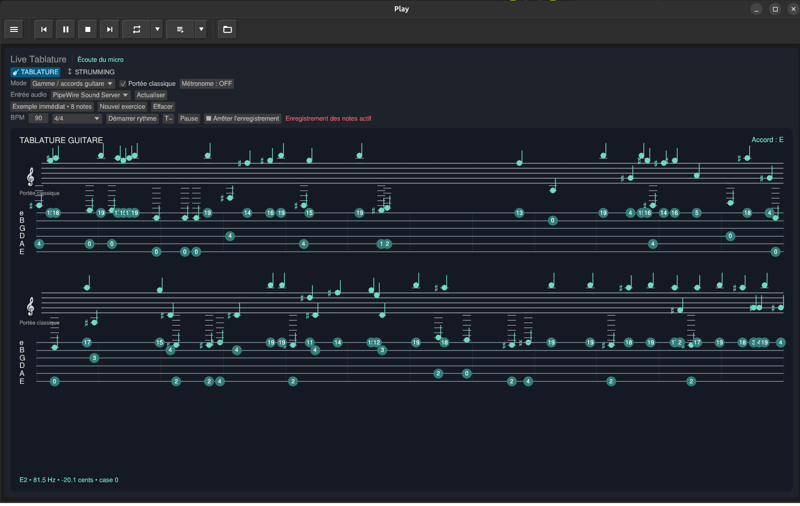

# Play

Play est le playground multiplateforme issu des idées et des applications de
`Exec_modernise` V1. Le projet vise Linux, Windows et macOS avec un modèle
partagé en Rust et une interface native de bureau portée directement par
`egui`.

Le workspace est organisé en applications (`apps/`) et bibliothèques
partagées (`crates/`). L'interface desktop assemble ces bibliothèques sans
faire entrer `egui`, `winit` ou les API audio système dans les contrats
portables.

## État actuel

Le binaire `play` ouvre une fenêtre native `winit` rendue par `egui-wgpu`. La
session démarre avec une liste de pistes vide et propose :

- une barre d'outils compacte inspirée de TacticalGlobe, avec ses boutons
  38×38 et ses textures normale/enfoncée dans `assets/texture/` ;
- les commandes menu, précédent, lecture/pause, arrêt, suivant, répétition,
  enchaînement et chargement de fichiers ;
- le choix entre les modes `Player`, `RoomAnalyzer`, `LiveTablature` et `UiLab` ;
- une fenêtre de chargement permettant de sélectionner plusieurs musiques
  (`mp3`, `flac`, `wav`, `ogg`, `m4a`, `aac` et `opus`) ;
- une liste de pistes qui occupe l'espace disponible et défile lorsqu'elle
  devient trop longue, avec une sélection visuelle de la piste active ;
- une zone d'informations après la liste, avec la jaquette intégrée aux FLAC ;
- un analyseur spectral stéréo ancré dans la partie basse de la fenêtre, avec
  64 bandes d'amplitude superposées autour d'un axe central, comme le Player
  d'Exec Modernisé ;
- un double mètre stéréo à LED rondes, gradué en décibels, et deux faders L/R
  sur toute la hauteur du panneau droit, placés contre leur mètre respectif.

Le mode `LiveTablature` propose trois présentations : `Tablature`, `Portée` et
`Portée + tablature`. La portée classique et la tablature utilisent la même
horloge. Les barres de mesure et les subdivisions de temps sont calculées à
partir du BPM et de la mesure 4/4 affichée dans le panneau.



Documentation détaillée : [`docs/LIVE_TABLATURE.md`](docs/LIVE_TABLATURE.md) et
[`docs/ROOM_ANALYZER.md`](docs/ROOM_ANALYZER.md).

Le mode `RoomAnalyzer` ouvre une entrée audio sélectionnable et affiche un
analyseur mono haute résolution sur 256 bandes. Sa graduation couvre 0 à
110 dB, avec des repères fréquentiels de 16 Hz à 23 kHz. L'analyse est faite
sur le signal du microphone ou de l'entrée audio choisie et utilise toute la
zone centrale disponible.

Le mode `LiveTablature` reconnaît la hauteur dominante d'une guitare dans une
entrée audio, la convertit en position sur les six cordes et affiche une
tablature qui se remplit progressivement. Les notes détectées, les accords et
les notes MIDI sont conservés dans une file temporelle et défilent dans les
portées visibles. La largeur de la fenêtre détermine le nombre de notes
visibles et sa hauteur le nombre de systèmes affichés. `Play/Pause` contrôle
le défilement et l'enregistrement des notes possède sa propre commande. Le
panneau comprend également les onglets `TABLATURE` et `STRUMMING`, les
réglages BPM, mesure et métronome ainsi que les commandes d'exercice et
d'effacement. La portée classique peut être affichée seule ou avec la
tablature, avec des barres de mesure alignées sur les deux systèmes.

Le chargement ajoute les fichiers et leurs titres à la liste. Un clic sur une
piste ou sur Lecture démarre sa lecture ; Pause et Arrêt contrôlent la piste
active. Le spectre et les mètres suivent les échantillons de la piste en cours
de lecture.

## Organisation

```text
apps/play-desktop/       fenêtre native, toolbar et composition egui
crates/play-core/        document, pistes, transport et état du spectre
crates/play-media/       inspection d'images et analyse spectrale stéréo
crates/play-ui/          scènes et contrats de panneaux portables
assets/fonts/             polices FreeSans et Material Icons
assets/texture/           textures des boutons de la barre d'outils
docs/                     architecture et décisions du projet
```

## Bibliothèques

| Besoin | Bibliothèque | État | Rôle |
|---|---|---|---|
| Fenêtre et événements | `winit` + `egui-winit` | actif | fenêtre native et événements |
| Interface | `egui` | actif | widgets, panneaux et peintres |
| Rendu GPU | `egui-wgpu` | actif | rendu de l'interface |
| Modèle | `serde` | actif | contrats sérialisables dans `play-core` et `play-ui` |
| Images | `image` | actif | textures PNG et inspection RGBA |
| Métadonnées | `lofty` | actif | lecture des jaquettes intégrées aux FLAC |
| Analyse | traitement temporel | actif | analyse stéréo en 64 bandes, analyse mono haute résolution et détection de hauteur/accord |
| Sélection de fichiers | `rfd` | actif | fenêtre native de chargement des musiques |
| Audio | `rodio` + `cpal` + `symphonia` | actif | décodage et lecture des fichiers |
| Rééchantillonnage | `rubato` | prévu | adaptation des flux audio |
| Persistance | `ron` | actif | sauvegarde de la liste, de la piste sélectionnée et de sa position |

## Démarrage

Le projet utilise la toolchain stable déclarée dans `rust-toolchain.toml`.

Depuis la racine du workspace :

```bash
cargo run -p play-desktop
cargo check --workspace
cargo test --workspace
cargo fmt --all -- --check
```

Le binaire s'appelle `play`. Dans RustRover, ouvrir le `Cargo.toml` racine et
utiliser la configuration `Play Desktop` située dans
`.idea/runConfigurations/Play_desktop.xml`.

## Limites actuelles

Le mode Live Tablature utilise actuellement les entrées audio disponibles sur
la machine. La connexion MIDI directe à une pédale ou à un contrôleur, la
lecture d'un exercice enregistré et le clic sonore du métronome restent à
intégrer. Les commandes BPM, mesure et métronome sont déjà présentes dans
l'interface et leur état est conservé pendant la session.

## Suite prévue

1. ajouter la connexion MIDI directe et la lecture d'exercices enregistrés ;
2. ajouter le clic sonore du métronome et valider le mode `STRUMMING` ;
3. valider le packaging et le rendu sur Linux, Windows et macOS.
