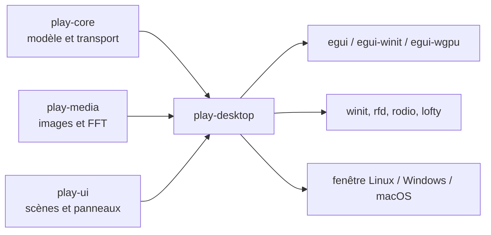
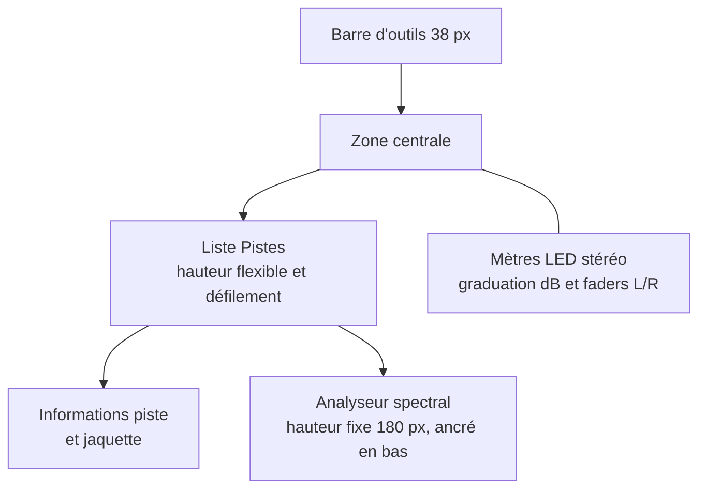
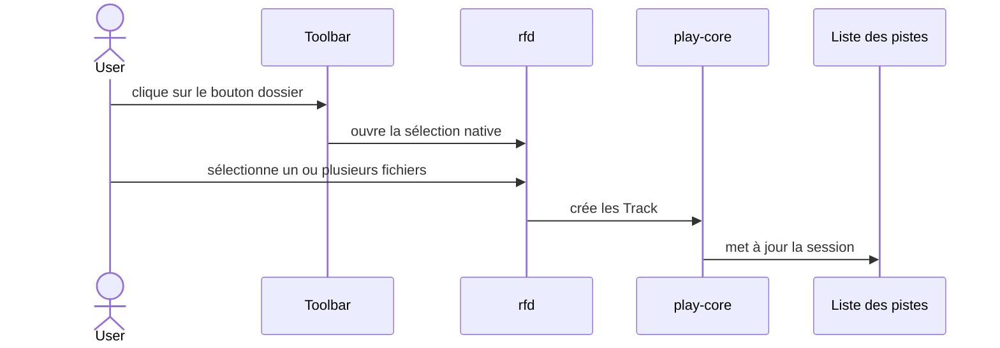

# Architecture de Play

Play reprend le découpage visible de `Exec_modernise` V1 sans reprendre son
noyau RISC-V, son ABI U-Mode ou son format ExecFS. Les contrats portables sont
séparés de l'application desktop afin que le modèle et les scènes puissent
être testés sans ouvrir de fenêtre.

## Vue des composants



`play-desktop` est le point d'assemblage. Il possède la boucle d'événements
`winit`, l'état `egui-winit`, le renderer `egui-wgpu`, la fenêtre de sélection
de fichiers et les interactions de la toolbar.

## Bibliothèques

### `play-core`

Cette crate est `no_std` avec `alloc`. Elle définit les contrats partagés :

- `WorkspaceMode` : `Player`, `RoomAnalyzer` et `UiLab` ;
- `TransportState` : `Stopped`, `Playing` et `Paused` ;
- `Track` et `ProjectDocument` pour la session et la liste de pistes ;
- `SpectrumSnapshot` pour les 32 niveaux et la crête ;
- `Workspace` pour regrouper document, transport et spectre.

Elle ne dépend ni d'`egui`, ni de `wgpu`, ni d'une API audio système.

### `play-media`

Cette crate contient le traitement média indépendant de l'interface. Elle
fournit actuellement :

- `inspect_image`, qui valide une image et expose ses dimensions RGBA ;
- `SpectrumAnalyzer`, qui applique une fenêtre de Hann, calcule une FFT et
  normalise le résultat en 32 bandes logarithmiques.

Le sample rate actuel du desktop est de 48 kHz. Les entrées audio et les
décodeurs restent à intégrer.

### `play-ui`

Cette crate est également `no_std` avec `alloc`. Elle définit `Scene` et
`PanelId`, donc le mode sélectionné et les panneaux visibles, sans contenir le
code de rendu `egui`.

## Composition de la fenêtre



La toolbar utilise les textures `assets/texture/bouton_normal.png` et
`assets/texture/bouton_enfoncer.png`, chargées par `egui` avec un filtrage
`NEAREST`. L'icône Material Icons est peinte par-dessus la texture et sa
couleur passe au jaune au survol ou lorsque la commande est active.

La zone centrale calcule la hauteur de la liste après le titre `Pistes`. Elle
réserve ensuite l'espace de la zone d'informations, du spectre et des
espacements. Ainsi, le cadre de la liste s'étend ou se réduit avec la fenêtre
tandis que les informations restent juste sous la liste et le spectre dans la
partie basse. Le panneau droit conserve toute la hauteur disponible pour les
mètres LED et les faders stéréo.

## Flux de chargement des musiques



Les fichiers sélectionnés sont mémorisés dans l'état desktop pour éviter les
doublons. Leur nom sans extension devient le titre de piste et l'artiste
affiche `Fichier local`. Un clic sur une piste démarre son décodage et sa
lecture avec `rodio`; le bouton Lecture reprend la piste active ou démarre la
première piste chargée. La piste active est surlignée dans la liste. Lorsqu'un
FLAC contient une image intégrée, `lofty` la lit et le desktop l'affiche dans
la zone d'informations située sous la liste.

## Vérification

Les commandes de validation sont :

```bash
cargo check --workspace
cargo test --workspace
cargo fmt --all -- --check
```

Les tests actuels vérifient la transition du transport et la production des 32
bandes spectrales. La prochaine couche de tests devra couvrir le décodage,
l'audio réel et la persistance des sessions.

## Évolutions prévues

1. ajouter `ron` pour sauvegarder et recharger une session ;
2. extraire les composants Player, RoomAnalyzer et UiLab partageables ;
3. valider les chemins de packaging des trois plateformes.
