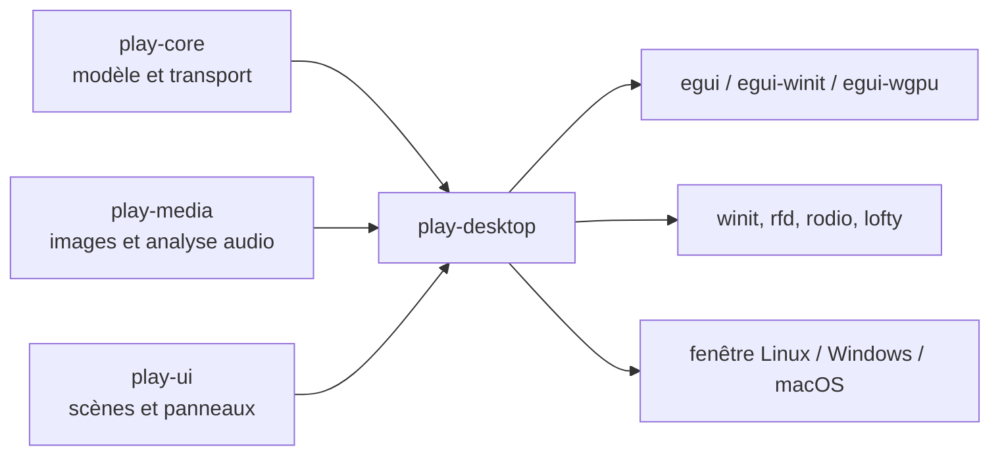
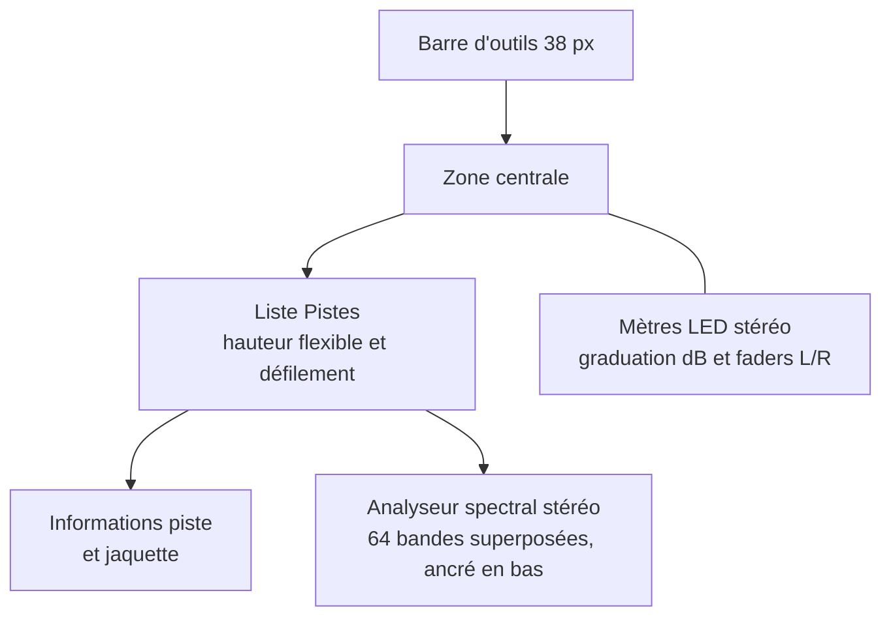
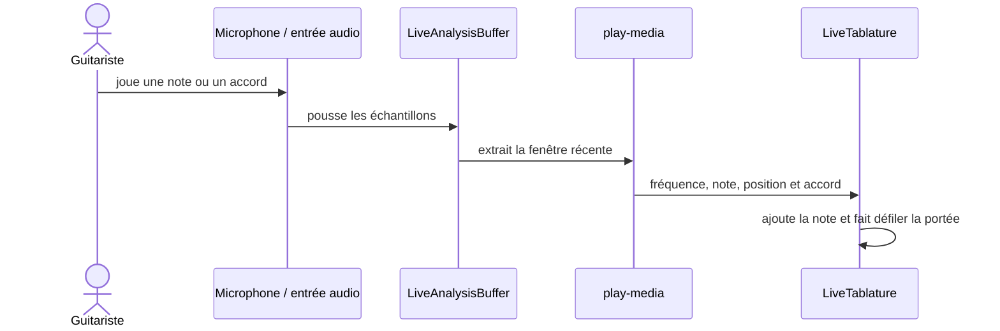
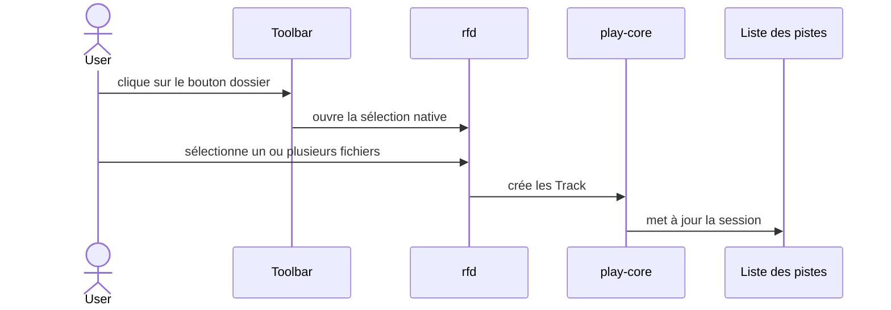

# Architecture de Play

Play reprend le découpage visible de `Exec_modernise` V1 sans reprendre son
noyau RISC-V, son ABI U-Mode ou son format ExecFS. Les contrats portables sont
séparés de l'application desktop afin que le modèle et les scènes puissent
être testés sans ouvrir de fenêtre.

## Vue des composants



`play-desktop` est le point d'assemblage. Il possède la boucle d'événements
`winit`, l'état `egui-winit`, le renderer `egui-wgpu`, la fenêtre de sélection
de fichiers et les interactions de la toolbar.

## Bibliothèques

### `play-core`

Cette crate est `no_std` avec `alloc`. Elle définit les contrats partagés :

- `WorkspaceMode` : `Player`, `RoomAnalyzer`, `LiveTablature` et `UiLab` ;
- `TransportState` : `Stopped`, `Playing` et `Paused` ;
- `Track` et `ProjectDocument` pour la session et la liste de pistes ;
- `SpectrumSnapshot` pour les niveaux et la crête ;
- `Workspace` pour regrouper document, transport et spectre.

Elle ne dépend ni d'`egui`, ni de `wgpu`, ni d'une API audio système.

### `play-media`

Cette crate contient le traitement média indépendant de l'interface. Elle
fournit actuellement :

- `inspect_image`, qui valide une image et expose ses dimensions RGBA ;
- `SpectrumAnalyzer`, qui calcule 64 niveaux d'amplitude stéréo sur des
  portions temporelles du bloc audio, comme l'analyseur du Player d'Exec
  Modernisé ;
- `analyze_with_band_count`, qui permet au Room Analyzer d'utiliser 256 bandes
  mono avec une résolution fréquentielle supérieure ;
- `detect_pitch`, qui estime la fréquence fondamentale, la note MIDI et les
  cents ;
- `detect_chord`, qui estime la fondamentale et la qualité d'un accord à partir
  de l'énergie chromatique.

Le sample rate et le nombre de canaux sont récupérés dans la configuration de
l'entrée ou du fichier audio. Les flux microphone et les décodeurs sont
assemblés dans `play-desktop` autour des buffers d'analyse.

### `play-ui`

Cette crate est également `no_std` avec `alloc`. Elle définit `Scene` et
`PanelId`, donc le mode sélectionné et les panneaux visibles, sans contenir le
code de rendu `egui`.

## Composition de la fenêtre



La toolbar utilise les textures `assets/texture/bouton_normal.png` et
`assets/texture/bouton_enfoncer.png`, chargées par `egui` avec un filtrage
`NEAREST`. L'icône Material Icons est peinte par-dessus la texture et sa
couleur passe au jaune au survol ou lorsque la commande est active.

La zone centrale calcule la hauteur de la liste après le titre `Pistes`. Elle
réserve ensuite l'espace de la zone d'informations, du spectre et des
espacements. Ainsi, le cadre de la liste s'étend ou se réduit avec la fenêtre
tandis que les informations restent juste sous la liste et le spectre dans la
partie basse. Le panneau droit conserve toute la hauteur disponible pour les
mètres LED et les faders stéréo.

## Room Analyzer

Voir aussi [`ROOM_ANALYZER.md`](ROOM_ANALYZER.md) pour le détail de la capture,
de la résolution fréquentielle et du flux de traitement.

Le Room Analyzer ouvre un flux d'entrée avec `rodio::microphone` et le place
dans un buffer partagé avec la boucle d'interface. À chaque image, le desktop
extrait la fenêtre audio la plus récente, la convertit en mono et la transmet à
`SpectrumAnalyzer::analyze_with_band_count` avec 256 bandes.

Les niveaux sont affichés positivement sur une échelle de 0 à 110 dB, de 16 Hz
à 23 kHz, et le graphe occupe toute la zone centrale du mode. Le choix de
l'entrée et les erreurs d'ouverture sont affichés au-dessus du graphe.

## Live Tablature

Voir aussi [`LIVE_TABLATURE.md`](LIVE_TABLATURE.md) pour les trois modes
d'affichage, la détection des notes et la synchronisation des mesures.

Le Live Tablature réutilise le même flux d'entrée et la même fenêtre d'analyse.
La détection de hauteur produit une note MIDI, puis `guitar_position` choisit
la position la plus grave disponible sur les six cordes dans les vingt
premières cases. Une détection d'accord est affichée dans l'en-tête.

Les positions reconnues sont ajoutées à une file temporelle limitée. Le
sélecteur d'affichage propose une tablature seule, une portée classique seule
ou les deux. La tablature est dessinée avec six lignes (`e B G D A E`) et la
portée classique avec cinq lignes et une clé de sol. Les deux systèmes
partagent les mêmes positions de notes et les mêmes barres de mesure. La durée
visible d'un système dépend de sa largeur, ce qui permet d'afficher davantage
de notes lorsque la fenêtre est agrandie.
`Play/Pause` suspend ou reprend le défilement et l'ajout de notes, tandis que
`Enregistrer les notes` contrôle séparément la capture des positions détectées.
Les contrôles pédagogiques comprennent les onglets `TABLATURE` et
`STRUMMING`, le choix de mode, le choix d'affichage, le BPM, la mesure, le
métronome, les exercices et l'effacement de la tablature. L'horloge des
mesures démarre avec la première note capturée et est suspendue avec le
défilement.

Le flux actuel est audio. La connexion MIDI directe, la lecture d'un exercice
enregistré et la génération sonore du métronome sont des extensions à prévoir.



## Flux de chargement des musiques



Les fichiers sélectionnés sont mémorisés dans l'état desktop pour éviter les
doublons. Leur nom sans extension devient le titre de piste et l'artiste
affiche `Fichier local`. Un clic sur une piste démarre son décodage et sa
lecture avec `rodio`; le bouton Lecture reprend la piste active ou démarre la
première piste chargée. La piste active est surlignée dans la liste. Lorsqu'un
FLAC contient une image intégrée, `lofty` la lit et le desktop l'affiche dans
la zone d'informations située sous la liste.

## Vérification

Les commandes de validation sont :

```bash
cargo check --workspace
cargo test --workspace
cargo fmt --all -- --check
```

Les tests actuels vérifient la transition du transport, les niveaux
d'amplitude, la résolution des basses fréquences, la détection de hauteur et
la détection d'accord. La prochaine couche de tests devra couvrir le décodage,
l'audio réel, la file temporelle de tablature et la persistance des sessions.

## Évolutions prévues

1. ajouter la connexion MIDI directe et la lecture d'exercices enregistrés ;
2. extraire les composants Player, RoomAnalyzer et LiveTablature partageables ;
3. valider les chemins de packaging des trois plateformes.
